# Arquitectura Web de Tres Niveles en Máquinas Virtuales

**Estudiante:** Ángel Hidalgo Morales  
**Curso:** 2º ASIR  

---

## Índice
1. [Introducción](#1-introducción)
2. [Diseño de la infraestructura](#2-diseño-de-la-infraestructura)
3. [Configuración de red y seguridad](#3-configuración-de-red-y-seguridad)
4. [Despliegue y aprovisionamiento de las máquinas](#4-despliegue-y-aprovisionamiento-de-las-máquinas)
5. [Certificado SSL con Certbot y Let's Encrypt](#5-certificado-ssl-con-certbot-y-lets-encrypt)
6. [Demostración de funcionamiento (Screencast)](#6-demostración-de-funcionamiento)

---

## 1. Introducción
El objetivo de esta práctica es desplegar y asegurar una arquitectura web distribuida en tres capas (balanceo de carga, servidores web de aplicación y base de datos) utilizando virtualización con VirtualBox y aprovisionamiento automatizado mediante Vagrant.

Con este diseño se consigue alta disponibilidad repartiendo el tráfico entre dos nodos web y aislamiento de seguridad por capas, exponiendo únicamente el balanceador a la red externa y cifrando las comunicaciones mediante HTTPS con Let's Encrypt.

---

## 2. Diseño de la infraestructura
La infraestructura consta de cuatro máquinas virtuales Debian 12 separadas en tres redes independientes:

* **Capa 1 - Red Pública (`192.168.1.41` / `10.0.1.1`):** Máquina `AngelHidalgoMoralesBalanceador` con Nginx configurado como proxy inverso.
* **Capa 2 - Red Privada Web (`10.0.1.0/24` y `10.0.3.0/24`):** Máquinas `AngelHidalgoMoralesWeb1` (`10.0.1.11` / `10.0.3.11`) y `AngelHidalgoMoralesWeb2` (`10.0.1.12` / `10.0.3.12`) con Apache2 y PHP.
* **Capa 3 - Red Privada Base de Datos (`10.0.3.20`):** Máquina `AngelHidalgoMoralesBBDD` con MariaDB Server, accesible únicamente desde la red interna de Capa 3.

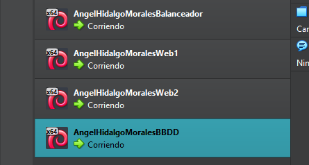

---

## 3. Configuración de red y seguridad

### 3.1. Direccionamiento IP
Cada instancia dispone de interfaces configuradas estáticamente en sus respectivas redes internas para aislar el tráfico entre capas:

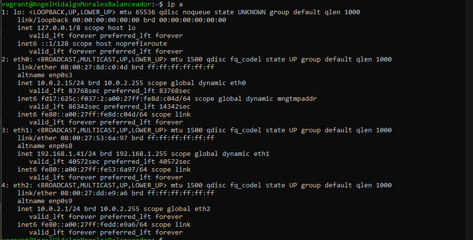

### 3.2. Listas de Control de Acceso y Cortafuegos (`iptables`)
Para restringir el tráfico a nivel de subred e instancia, se ha establecido la política por defecto en `DROP` en todas las máquinas, abriendo exclusivamente los puertos necesarios desde los orígenes autorizados:
* **Balanceador:** Permite tráfico entrante en los puertos 80 (HTTP), 443 (HTTPS) y 22 (SSH).
* **Servidores Web 1 y 2:** Permiten tráfico HTTP (80) únicamente desde la subred privada del balanceador (`10.0.1.0/24`).
* **Base de Datos:** Permite conexiones al puerto 3306 exclusivamente desde la subred privada de los servidores web (`10.0.3.0/24`).

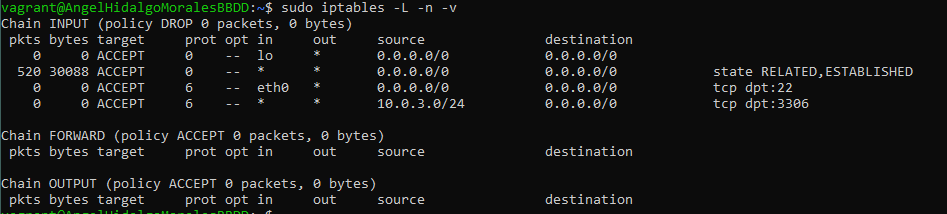
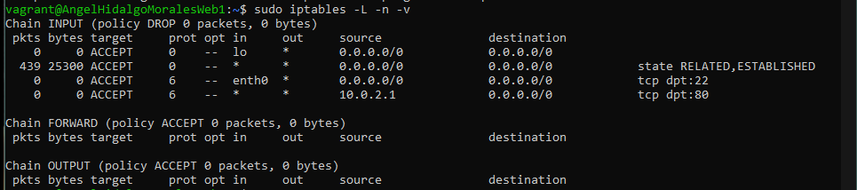
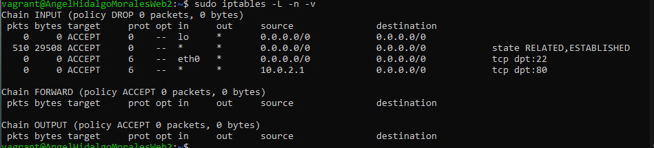
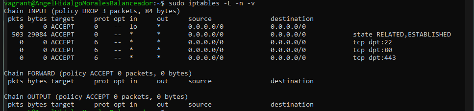

---

## 4. Despliegue y aprovisionamiento de las máquinas
El despliegue de las cuatro instancias y la instalación de sus servicios se ha automatizado mediante un archivo `Vagrantfile`.

### 4.1. Balanceador de Carga (`AngelHidalgoMoralesBalanceador`)
Se instaló Nginx y se configuró un bloque `upstream` apuntando a los dos servidores backend de la segunda capa (`10.0.1.11` y `10.0.1.12`).

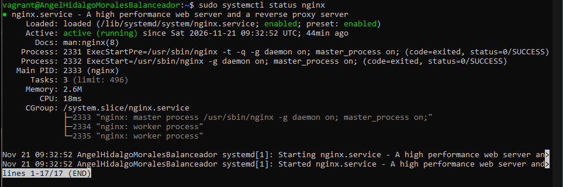

### 4.2. Servidores Web Backend (`AngelHidalgoMoralesWeb1` y `AngelHidalgoMoralesWeb2`)
En ambas máquinas se instaló Apache2 y PHP con soporte MySQL (`php-mysql`), desplegando una aplicación web que identifica qué servidor atiende cada petición y verifica la conexión con la base de datos de Capa 3 (`10.0.3.20`).

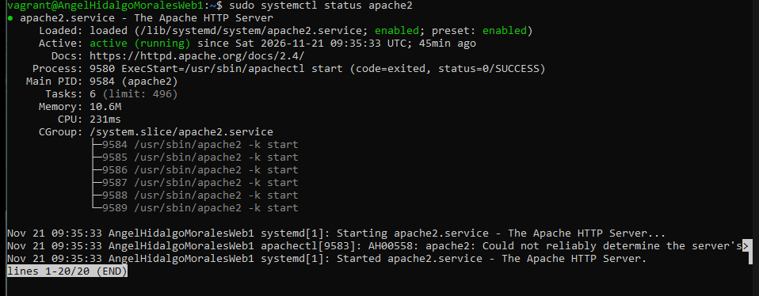
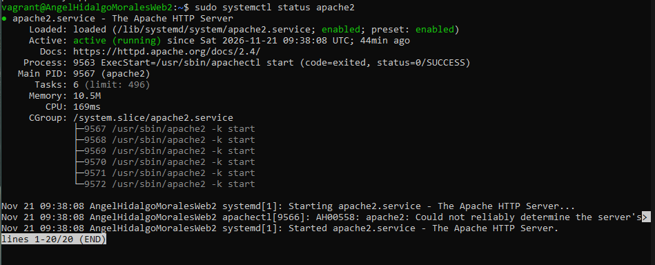

### 4.3. Servidor de Base de Datos (`AngelHidalgoMoralesBBDD`)
Se instaló MariaDB Server configurando la escucha en la red privada (`10.0.3.20`) y creando la base de datos `practica` junto con un usuario con permisos restringidos a la subred `10.0.3.%`.

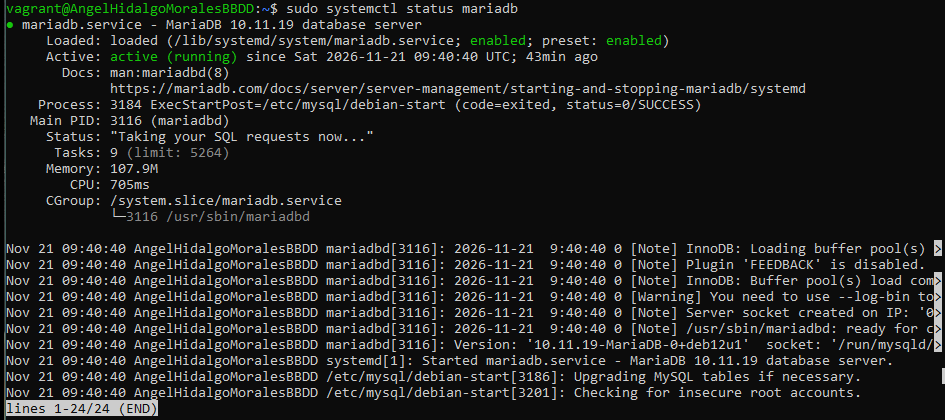

---

## 5. Certificado SSL con Certbot y Let's Encrypt
Se asoció el dominio `angelhidalgoasir.duckdns.org` a la dirección pública del balanceador y se ejecutó Certbot mediante validación DNS-01 para emitir e instalar un certificado TLS válido de Let's Encrypt en Nginx, forzando la redirección de HTTP a HTTPS.

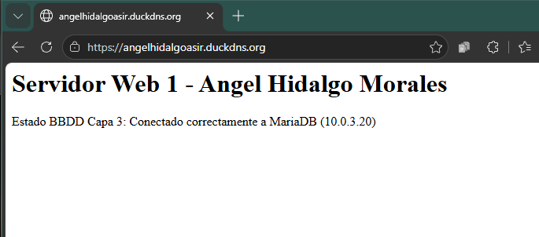

---

## 6. Demostración de funcionamiento
En este mismo repositorio se incluye el vídeo `screencast.mp4`, donde se demuestra el acceso seguro a través de HTTPS, el balanceo de carga alternando entre `AngelHidalgoMoralesWeb1` y `AngelHidalgoMoralesWeb2` al recargar el navegador, y la conexión activa con `AngelHidalgoMoralesBBDD`.

**[Ver vídeo de demostración (screencast.mp4)](screencast.mp4)**